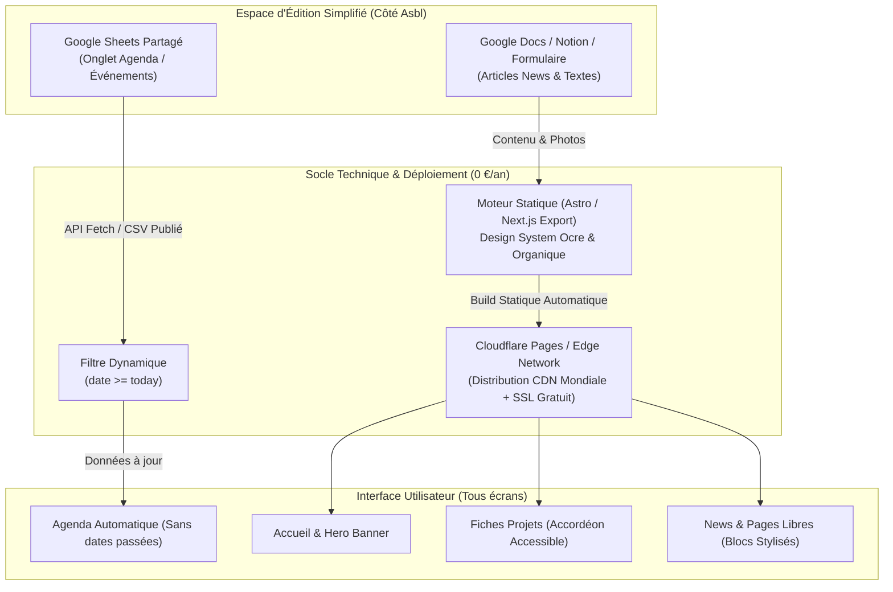

# ADR-001: Architecture Découplée & Stratégie Éditoriale Éco-conçue pour Transversale asbl

* **Statut :** Retenu (Accepted)
* **Date :** 2026-11-18
* **Auteur :** Boris Rorsvort (Aubuscule)
* **Contexte :** Refonte du site web et de l'identité visuelle de Transversale asbl

---

## 1. Contexte & Problématique

L'association **Transversale asbl** dispose actuellement d'un site sous WordPress.com avec un abonnement Elementor facturé **100 €/an**, avec nom de domaine et hébergement chez OVH.

Leur modèle d'exploitation actuel présente trois frictions majeures :
1. **Coût disproportionné :** 100 €/an de licences pour un site vitrine mis à jour ~1 fois par mois.
2. **Fragilité & maintenance :** Les mises à jour fréquentes d'Elementor et de WordPress créent des risques réguliers de régression, d'incompatibilité d'extensions ou de failles de sécurité, alors que l'asbl n'a aucune compétence technique interne.
3. **Friction opérationnelle :** La gestion de l'agenda nécessite une manipulation manuelle constante pour masquer les dates passées, sous peine de donner une impression de site à l'abandon.

L'objectif architectural est de fournir une solution **la plus économique possible (0 €/an de frais récurrents)**, **inattaquable et pérenne sur 5 ans** (zéro maintenance logicielle), tout en offrant :
- Une synchronisation transparente de l'agenda via un tableur familier (Google Sheets) avec masquage automatique des dates expirées.
- Une palette d'options de mise en page agréables et structurées (texte/image) pour les contenus éditoriaux (News / À propos).
- Une flexibilité totale pour absorber des évolutions futures (multilingue FR/NL, billetterie, fiches artistes étendues).

---

## 2. Facteurs de Décision (Decision Drivers)

| Facteur | Exigence |
|---|---|
| **Coût d'exploitation** | **0 €/an** de licence logicielle ou de serveur dédié (respect strict du budget associatif). |
| **Robustesse & Résilience** | Zéro maintenance technique requise : pas de base de données SQL exposée, pas de failles PHP, 100% de disponibilité. |
| **Simplicité client** | Outils d'édition sans apprentissage : Google Sheets pour les dates et gabarits visuels pré-stylisés pour le contenu. |
| **Esthétique & Identité** | Respect du cahier des charges « moderne ethnic », matière, organique, tons chauds ocre/brun. |
| **Extensibilité** | Capacité à activer le multilingue (i18n) ou des modules futurs sans restructurer le socle. |

---

## 3. Comparatif des Options Évaluées

### Option A : CMS Headless dans le Cloud (ex : Sanity.io / Strapi / Decap CMS)
* **Description :** Frontend découplé connecté à une plateforme de gestion de contenu SaaS ou hébergée.
* **Avantages :** Interface de saisie sur mesure, modélisation de blocs très fine.
* **Inconvénients / Risques :** 
  - Dépendance envers les quotas et politiques tarifaires de tiers (risques de passage payant).
  - Décision disproportionnée pour un rythme de mise à jour mensuel.
  - Complexité de configuration et de formation client hors budget (600 € – 1 000 €).

### Option B : WordPress Nettoyé (Sans Elementor, Blocs Gutenberg purs sur OVH)
* **Description :** Conservation de WordPress sur l'hébergement mutualisé OVH existant, avec thème sur mesure basé sur Gutenberg.
* **Avantages :** Utilise l'hébergement OVH déjà payé.
* **Inconvénients / Risques :**
  - Maintient la dette technique de l'écosystème WordPress (mises à jour de sécurité PHP/MySQL récurrentes, spams de formulaires).
  - Performances médiocres sur l'offre mutualisée OVH par rapport à un réseau CDN mondial.
  - Risque élevé de rupture si l'asbl installe des extensions tierces par inadvertance.

### Option C (Retenue) : Architecture JAMstack Découplée (Générateur Statique + Google Sheets API + Blocs Éditoriaux Pré-stylisés sur CDN Gratuit)
* **Description :** Site statique ultra-performant (généré via Next.js ou Astro), hébergé gratuitement sur Cloudflare Pages (ou déposé en fichiers statiques sur OVH), consommant les événements via Google Sheets en temps réel ou au déploiement, et structurant les pages éditables avec une palette de blocs CSS/HTML robustes.
* **Avantages :**
  - **Coût serveur = 0 €/an** à vie.
  - **Sécurité absolue & Vitesse :** Fichiers HTML/CSS distribués sur CDN mondial, chargement quasi instantané, impossible à pirater.
  - **Filtre automatique des dates :** Traitement natif JavaScript/SWR `date >= today` sans plugin payant.
  - **Zéro dette technique :** Le site fonctionnera à l'identique dans 5 ans sans nécessiter aucune mise à jour de sécurité.

---

## 4. Décision & Architecture Détaillée

Nous retenons l'**Option C : Architecture JAMstack Découplée**.

### Schéma d'Architecture & Flux de Données

---

## 5. Stratégie de Mise en Page pour les Contenus Éditables (The Layout Block Palette)

Pour répondre au besoin d'avoir des options de mise en page agréables et variées pour les textes et photos sans la lourdeur d'un page builder, nous mettons en place un système de **5 Blocs Éditoriaux Harmonisés** :

1. **Bloc 01 — *Le Récit Standard* :**
   - Chapeau de texte en grand corps pour l'accroche.
   - Corps d'article fluide et typographié avec élégance.
   - Grande image centrale immersive avec légende discrète.
2. **Bloc 02 — *Le Duo Asymétrique (Magazine)* :**
   - Colonne texte à gauche / visuel à droite (ou inversement), avec fond sable/matière texturé. Idéal pour présenter un nouvel artiste ou une résidence de création.
3. **Bloc 03 — *Le Manifeste / Citation Artiste* :**
   - Citation en typographie de caractère mise en valeur sur fond ocre chaud, avec signature de l'auteur. Parfait pour véhiculer la voix et l'engagement du collectif.
4. **Bloc 04 — *La Grille Visuelle (Triptyque d'ambiance)* :**
   - Présentation de 2 ou 3 clichés de festival/scène côte à côte, avec agrandissement plein écran (lightbox ultra-légère).
5. **Bloc 05 — *L'Encart d'Action (Call-to-Action)* :**
   - Bloc délimité en terre cuite avec bouton interactif (lien vers billetterie, formulaire d'adhésion, ou contact mail direct).

### Mécanisme de publication au quotidien :
Le client prépare ses textes et photos dans un **Google Doc ou une fiche Notion partagée**. Chaque publication est formatée en appliquant directement les styles pré-définis, garantissant qu'aucune fausse manipulation ne puisse casser la grille ou l'identité visuelle du site.

---

## 6. Évolutivité & Extensibilité Future

Même si les besoins d'évolution sont rares, le socle architectural est conçu pour accueillir sans refonte :
- **Multilinguisme (i18n) :** Le routage est nativement préparé pour l'adjonction d'un préfixe de langue (`/nl/`, `/en/`).
- **Billetterie & Réservations :** Intégration par simple composant iFrame ou bouton externe (Luma, Billetweb, Weezevent).
- **Kit Presse & EPK :** Ajout de routes dédiées pour les programmateurs en réutilisant les composants de fiches artistes.

---

## 7. Plan de Validation & Recettage

1. **Test de synchronisation Google Sheets :** Vérification du délai de rafraîchissement des dates (< 2 secondes) et du masquage strict des dates passées.
2. **Audit de performance & accessibilité :** Score Lighthouse visé : 95+ en Performance, 100 en SEO et Accessibilité.
3. **Élimination des coûts :** Confirmation de résiliation du compte Elementor et bascule DNS propre depuis OVH sans interruption de service.
